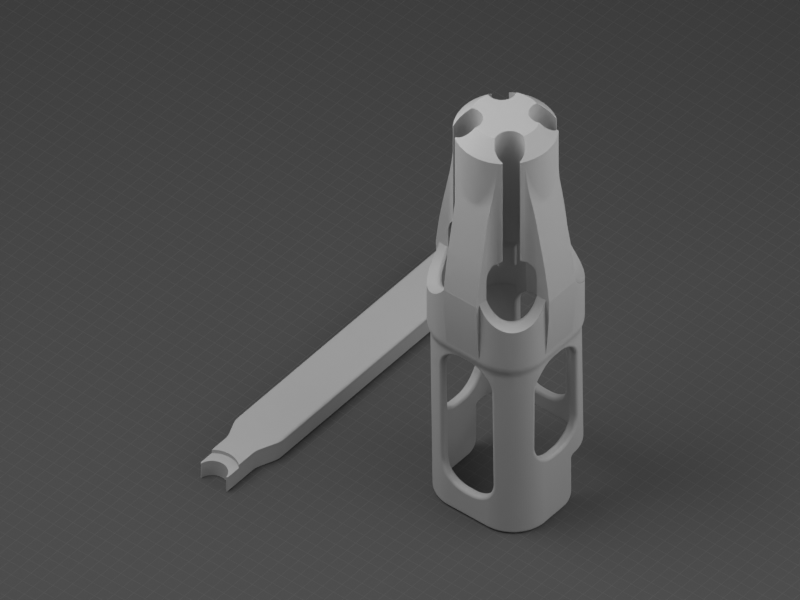

# AMS-Lite

Conectores, guías de tubos PTFE y protección del hub de AMS Lite.

| Vista previa | Modelo | Contenido |
| --- | --- | --- |
|  | [Conector PTFE](PTFE-Connector/) | Cuatro conectores PTFE para AMS Lite. |
|  | [Soporte y protección de tubos PTFE](Tube-Support/) | Guía de tubos PTFE y protección del hub, con herramienta para liberar los tubos. |
