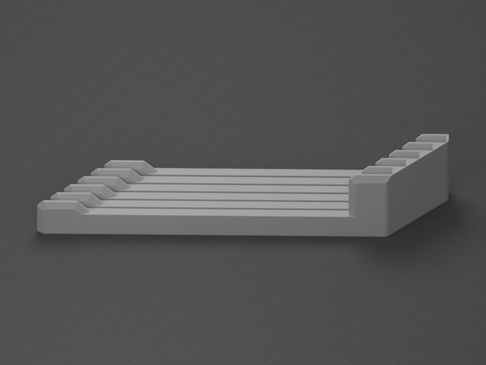

# Build-Plates

Soportes y organizadores para las placas de impresión.

| Vista previa | Modelo | Contenido |
| --- | --- | --- |
|  | [Soporte para cinco placas](Plate-Holder/) | Organizador de una pieza para guardar hasta cinco placas de impresión. |
