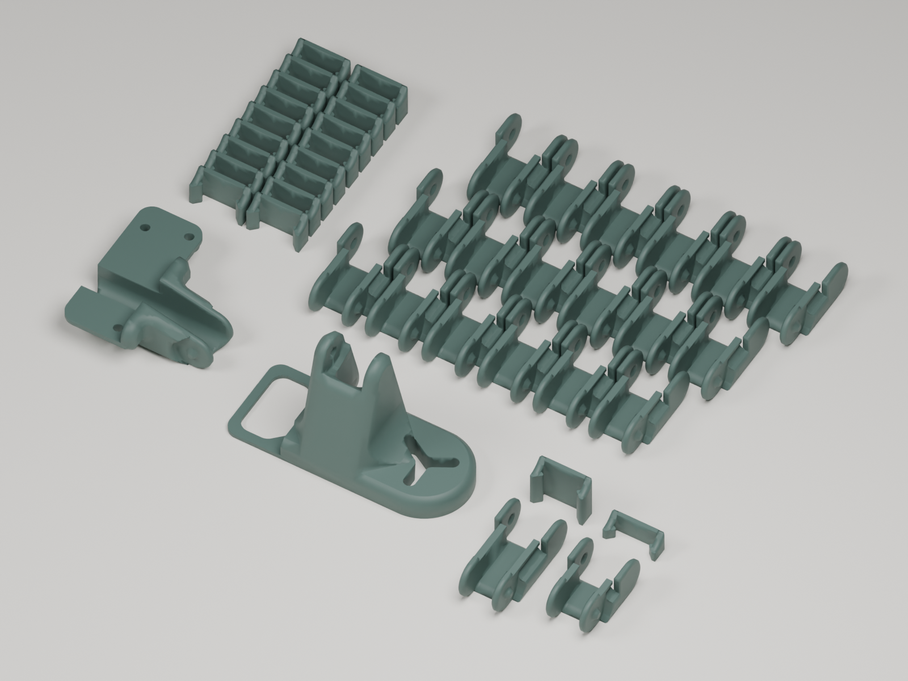

# Cadena de la cama · conector plano A1 2026

La pieza **plana para 2026 es el archivo suelto `obj_42+bed+mount.3mf`**
aportado por el mantenedor. El conjunto completo RV01 se ha actualizado para
usar exactamente esa geometría, sustituyendo su conector antiguo.

## Archivos activos

| Archivo | Contenido |
| --- | --- |
| [obj_42+bed+mount.3mf](Files/obj_42+bed+mount.3mf) | Conector plano 2026 original aportado, restaurado sin cambiar sus bytes |
| [A1+bed+dragchain+RV01.3mf](Files/A1+bed+dragchain+RV01.3mf) | Conjunto completo de 42 objetos, con el conector plano 2026 en lugar del antiguo |
| [Bed-Mount-A1-2026.stl](Files/Bed-Mount-A1-2026.stl) | STL exportado del conector plano aportado |

## Conector plano 2026


La pieza publicada corresponde a la malla del archivo suelto: **8.803 vértices
y 17.610 triángulos**. Su SHA-256 original es
`9671025f6ada69c6bee01bf7811a6e0f56cad02db7317943331cfe0792ecad93`.

## Conjunto RV01 actualizado



- Se sustituyó únicamente el soporte antiguo del objeto 50.
- La malla plana reemplaza a la antigua de 21.186 triángulos.
- Los otros 41 objetos y todas las posiciones de impresión se conservan.
- La pieza plana se reorientó de forma rígida dentro del conjunto, sin escalarla.
- La geometría resultante coincide con el archivo suelto aportado.
- El conjunto fue abierto y exportado correctamente con Bambu Studio.

Las dimensiones exteriores del soporte son **72,75 × 29,50 × 43,20 mm**.
La identificación de la versión 2026 corresponde al mantenedor; el ajuste
físico permanece pendiente de prueba.

## Referencias de origen

- [Archivo suelto plano 2026 aportado](Sources/obj_42+bed+mount_Provided2026.3mf).
- [Conjunto RV01 original con el conector antiguo](Sources/A1+bed+dragchain+RV01_Original.3mf).
- [Registro de sustitución](Replacement.json) y [verificación](Verification.json).
- [Sumas SHA-256](SHA256SUMS.txt).

## Reproducir el cambio

El orden de los argumentos es **pieza plana suelta como origen, conjunto
completo original como destino**. El script rechaza la operación inversa.

```sh
python Scripts/Update-Bed-Mount-2026.py "Designs/A1-Modifications/Cable-Chains/Bed-Dragchain-2026/Sources/obj_42+bed+mount_Provided2026.3mf" "Designs/A1-Modifications/Cable-Chains/Bed-Dragchain-2026/Sources/A1+bed+dragchain+RV01_Original.3mf" --output LocalExports/Bed-Dragchain-Flat-2026.3mf
```

## Perfiles guardados y autoría

Se conservan los perfiles originales A1, boquilla de 0,4 mm y capas de 0,2 mm.
El archivo suelto conserva su perfil Generic PLA; el conjunto mantiene su
configuración original. Son proyectos editables y se deben laminar con los
ajustes correspondientes antes de imprimir.

Diseño original de **Kar Fai**. Los detalles de procedencia, perfiles y licencia
se recogen en [Attribution.md](Attribution.md).
