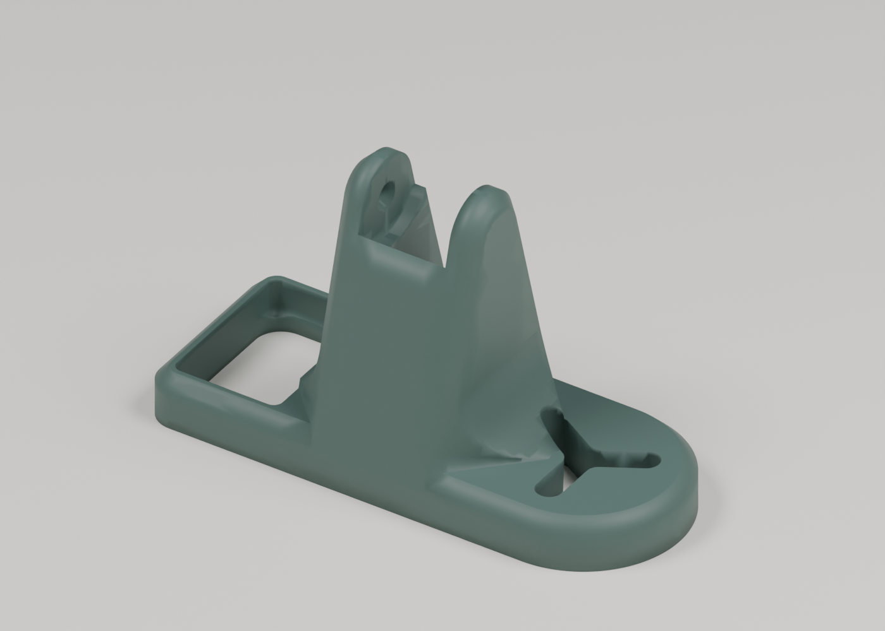

# Cadena de la cama y conector A1 2026

Conjunto de cadena portacables de la cama y soporte individual actualizado con la revisión del conector seleccionada para la A1 2026.

## Archivos

- [A1+bed+dragchain+RV01.3mf](Files/A1+bed+dragchain+RV01.3mf)
- [obj_42+bed+mount.3mf](Files/obj_42+bed+mount.3mf)



## Conector 2026 actualizado

El proyecto activo **[obj_42+bed+mount.3mf](Files/obj_42+bed+mount.3mf)** contiene
la malla `bed mount test 03 (0.325).stl`, objeto 50 del conjunto RV01. Sustituye
la pieza antigua; el proyecto individual continúa teniendo **un solo objeto**.

- Se aplicó la orientación del conjunto RV01 y se centró la pieza en la posición original.
- Dimensiones conservadas: **72,75 × 29,50 × 43,20 mm**, sin escalar.
- Malla anterior: 17.610 triángulos; malla revisada: 21.186 triángulos.
- Malla cerrada, un sólido conectado y perfil original A1 conservado.
- Importación y exportación comprobadas con Bambu Studio; ajuste físico pendiente.

También se incluye el [STL actualizado](Files/Bed-Mount-A1-2026.stl), el
[registro del reemplazo](Replacement.json) y la [verificación](Verification.json).
El [proyecto anterior](Sources/obj_42+bed+mount_Pre2026.3mf) queda identificado
como referencia previa, separado de los archivos activos.

Para reproducir el cambio desde la raíz del repositorio:

```sh
python Scripts/Update-Bed-Mount-2026.py "Designs/A1-Modifications/Cable-Chains/Bed-Dragchain-2026/Files/A1+bed+dragchain+RV01.3mf" "Designs/A1-Modifications/Cable-Chains/Bed-Dragchain-2026/Sources/obj_42+bed+mount_Pre2026.3mf" --output LocalExports/Bed-Mount-2026.3mf
```

La identificación de esta revisión para la A1 2026 procede del mantenedor.

## Perfiles guardados

| Archivo | Impresora del proyecto | Material | Capa |
| --- | --- | --- | --- |
| A1+bed+dragchain+RV01.3mf | Bambu Lab A1 | Bambu PLA Basic @BBL A1, Generic PLA @BBL A1 | 0.2 mm |
| obj_42+bed+mount.3mf | Bambu Lab A1 | Generic PLA @BBL A1 | 0.2 mm |

Estos datos describen los perfiles guardados en los archivos aportados.
Los modelos se archivan como proyectos 3MF editables, con sus ajustes y datos
de impresión. La compatibilidad física de estas mejoras con cada unidad
de impresora permanece sin probar en este archivo.

## Autoría y procedencia

Consulta [Attribution.md](Attribution.md) y [SHA256SUMS.txt](SHA256SUMS.txt).
Importado el **29 de octubre de 2026**.
