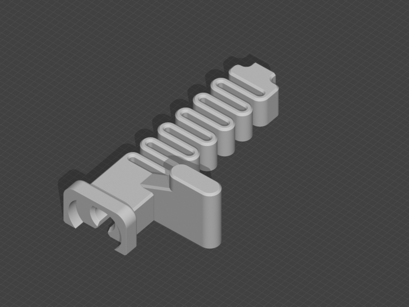

# Soporte de cable derecho del eje X

Protector del cable y del brazo de corte en el extremo derecho del eje X de la A1.

[Descargar modelo 3MF](Files/Right-Cable-Support.3mf)

[Fuente original en MakerWorld](https://makerworld.com/es/models/1758385-x-axis-right-cable-support-bambulab-a1) · Autor: **Lauvi Design** · Licencia: **Standard Digital File License**.

Proyecto para A1 con boquilla de 0,4 mm, PLA y capas de 0,2 mm. Conserva los soportes manuales del perfil.
