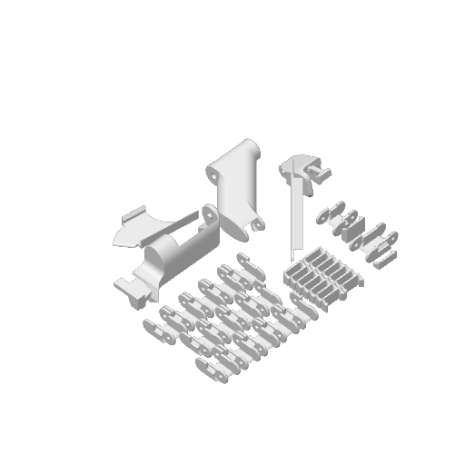

# Cadena portacables lateral V2.0

Conjunto lateral para guiar el cableado de la A1. Incluye los eslabones, clips y soportes guardados en el proyecto original.

## Archivos

- [A1+side+drag+chain+V2.0.3mf](Files/A1+side+drag+chain+V2.0.3mf)

## Perfiles guardados

| Archivo | Impresora del proyecto | Material | Capa |
| --- | --- | --- | --- |
| A1+side+drag+chain+V2.0.3mf | Bambu Lab A1 | Bambu PLA Basic @BBL A1, Generic PLA @BBL A1 | 0.2 mm |

Estos datos describen los perfiles guardados en los archivos aportados.
Los modelos se archivan como proyectos 3MF editables, con sus ajustes y datos
de impresión. La compatibilidad física de estas mejoras con cada unidad
de impresora permanece sin probar en este archivo.

## Autoría y procedencia

Consulta [Attribution.md](Attribution.md) y [SHA256SUMS.txt](SHA256SUMS.txt).
Importado el **29 de octubre de 2026**.
