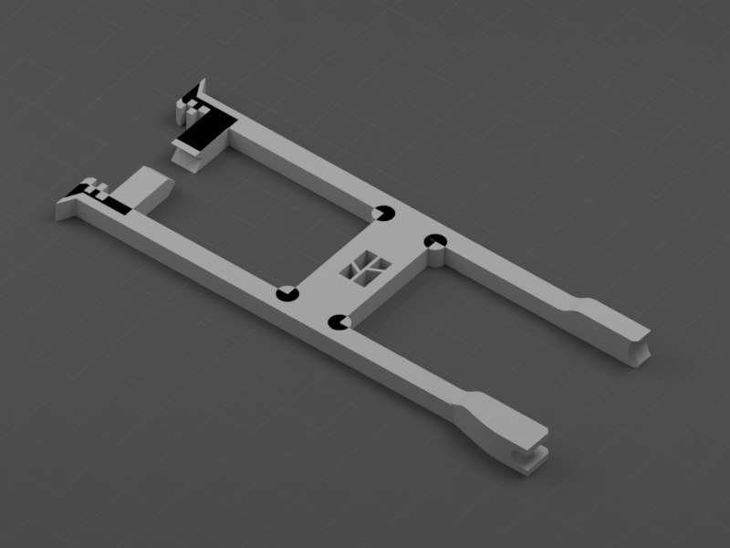

# A1-Modifications

Mejoras y accesorios para la Bambu Lab A1.

| Vista previa | Modelo | Contenido |
| --- | --- | --- |
|  | [Bed Dragchain](Cable-Chains/Bed-Dragchain/) | Cadena portacables de la cama de la A1, con el conector plano incluido en el conjunto. |
|  | [Side Dragchain](Cable-Chains/Side-Dragchain/) | Cadena portacables lateral de la A1, con sus eslabones, clips y soportes. |
|  | [Conector PTFE](AMS-Lite/PTFE-Connector/) | Cuatro conectores PTFE para AMS Lite. |
|  | [Mangos para llaves Allen](Tools/Allen-Keys-2026/) | Mangos seleccionados para las llaves del kit A1 2026. El diseño de origen se llama «SNAPMAKER U1 allen keys handle». |
|  | [Soporte para cinco placas](Build-Plates/Plate-Holder/) | Organizador de una pieza para guardar hasta cinco placas de impresión. |
|  | [Limpiador y deflector de purga](Nozzle/Purge-Wiper/) | Variante con logo en el limpiador y en el deflector grande, seleccionada de la versión 4. |
|  | [Soporte y protección de tubos PTFE](AMS-Lite/Tube-Support/) | Guía de tubos PTFE y protección del hub, con herramienta para liberar los tubos. |
|  | [Herramienta de mantenimiento del cabezal](Tools/Hotend-Tool/) | Herramienta para retirar la cubierta frontal, la funda de silicona y el conector del hub en A1 y A1 mini. |
