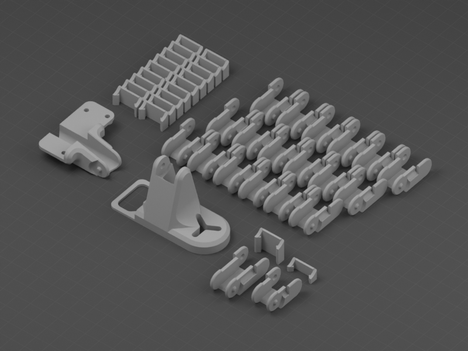
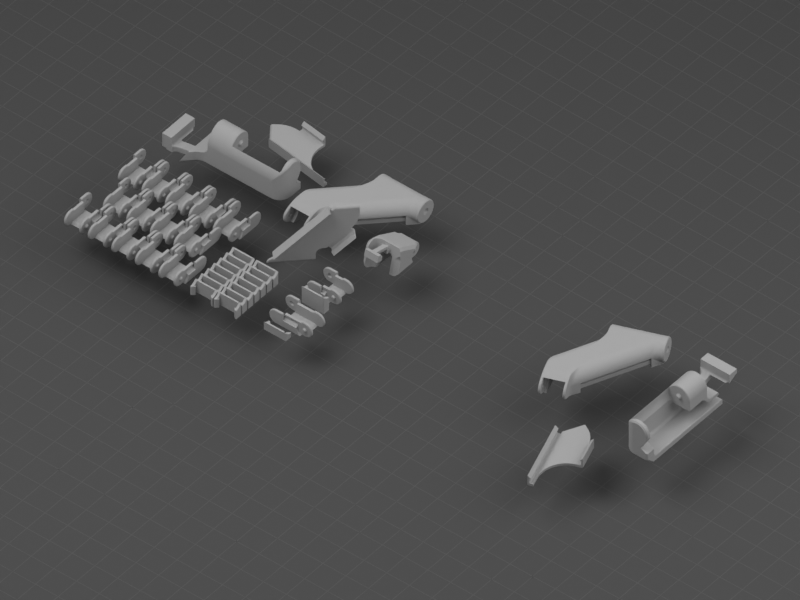
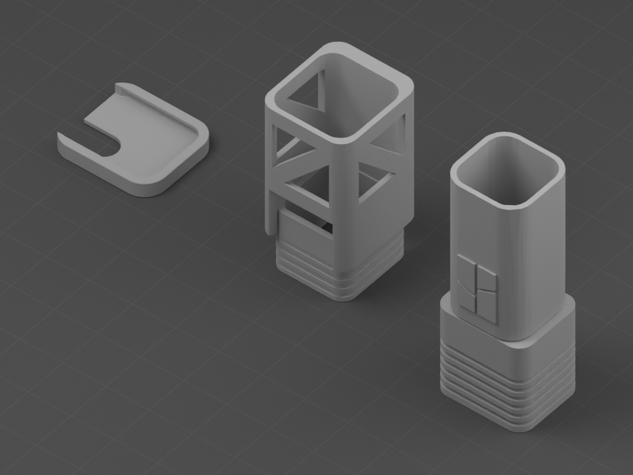
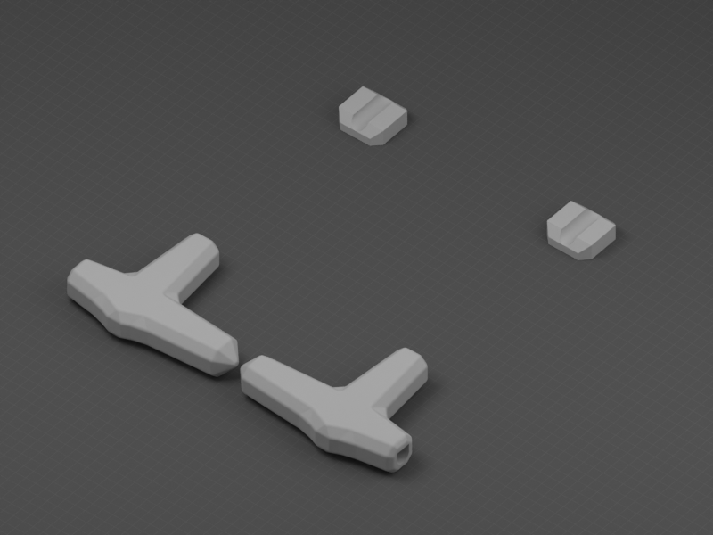

# A1-Modifications

Mejoras y accesorios para la Bambu Lab A1.

| Vista previa | Modelo | Contenido |
| --- | --- | --- |
|  | [Bed Dragchain](Cable-Chains/Bed-Dragchain/) | Cadena portacables de la cama de la A1, con el conector plano incluido en el conjunto. |
|  | [Side Dragchain](Cable-Chains/Side-Dragchain/) | Cadena portacables lateral de la A1, con sus eslabones, clips y soportes. |
|  | [Conector PTFE](AMS-Lite/PTFE-Connector/) | Cuatro conectores PTFE para AMS Lite. |
|  | [Hub Armor · Trio](AMS-Lite/Hub-Armor-Trio/) | Armadura del hub de AMS Lite, pieza para retirar soportes y cubierta. |
|  | [Mangos para llaves Allen](Tools/Allen-Keys-2026/) | Mangos seleccionados para las llaves del kit A1 2026. El diseño de origen se llama «SNAPMAKER U1 allen keys handle». |
