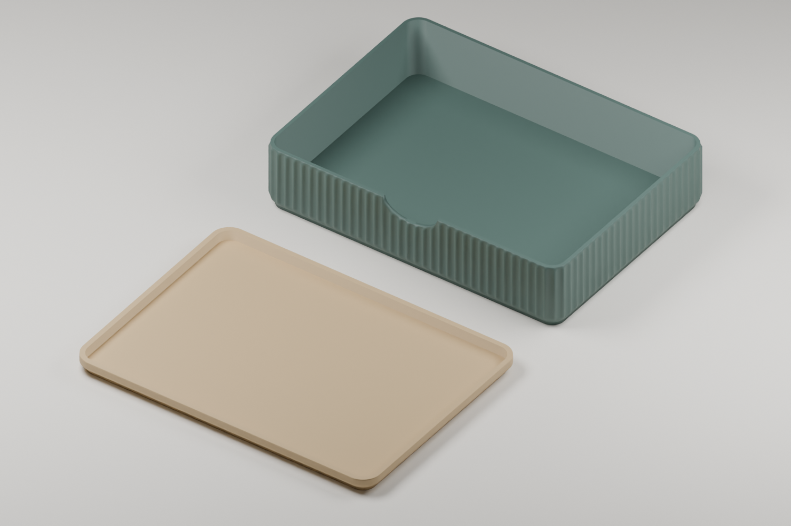

# StackBox · objeto de 105 × 147 × 28 mm

Modificación dimensional de **Japandi StackBox Modular Storage Box | No AMS**,
diseño original de **Agro1223**. La caja y su tapa se ajustaron juntas para
alojar un objeto rectangular de **10,5 × 14,7 × 2,8 cm**.



## Descargar

- [Proyecto 3MF para Bambu Studio, sin AMS](Files/StackBox_105x147x28mm_Holgura_NoAMS.3mf)
- [STL de la caja](Files/StackBox_Caja_105x147x28mm.stl)
- [STL de la tapa](Files/StackBox_Tapa_105x147x28mm.stl)
- [Medidas y uso](Medidas_y_uso.txt)
- [Configuración registrada](../../../Profiles/Process/StackBox-A1-0.28mm.snapshot.json)

Abre el 3MF como proyecto y vuelve a laminar antes de imprimir. Los STL están
expresados en milímetros. El 3MF incluye ambas piezas en una sola placa.

## Medidas

En esta tabla el orden es **ancho × largo × alto**.

| Elemento | Medidas, mm |
| --- | --- |
| Objeto previsto | 105 × 147 × 28 |
| Volumen rectangular útil comprobado, con tapa cerrada | 105,4 × 147,4 × 28,4 |
| Cavidad máxima entre paredes | 109,22 × 151,22 |
| Exterior de la caja | 114,32 × 156,32 × 33,11 |
| Exterior de la tapa | 114,32 × 156,32 × 8 |

Se añadieron **0,2 mm por lado** al volumen rectangular solicitado. La cavidad
es más amplia entre las paredes rectas para que ese rectángulo entre también
en las esquinas redondeadas.

## Modificaciones

- Ampliación de los tramos rectos de la caja y la tapa, conservando curvas,
  espesores y perfiles de encaje originales.
- Ajuste de altura teniendo en cuenta la parte de la tapa que entra en la caja.
- Conservación de la textura exterior, el rebaje frontal y las asignaciones de impresión.
- Colocación de ambas piezas en placa de 256 × 256 mm, separadas 8 mm.

## Perfil utilizado

| Ajuste | Valor archivado |
| --- | --- |
| Impresora y boquilla | Bambu Lab A1, 0,4 mm |
| Material | Bambu PLA Basic |
| Proceso base | 0.28mm Extra Draft @BBL A1 |
| Capa / capa inicial | 0,28 / 0,20 mm |
| Paredes | 2 |
| Relleno | 15 %, grid |
| Capas superiores / inferiores | 4 / 3 |
| Soportes | Desactivados |
| Filamentos del proyecto | 1 |

Son los ajustes conservados del archivo suministrado, no una recomendación
universal para cualquier material. El registro JSON permite consultarlos y
el 3MF conserva la configuración completa aplicada.

## Verificación

- Ambas mallas son cerradas, con orientación coherente y un solo componente.
- Una galga rectangular de 147,4 × 105,4 × 28,4 mm no intersecta la caja ni la tapa cerrada.
- Las piezas no presentan intersección significativa entre sí en posición de cierre.
- Se comprobó la apertura en Bambu Studio y se completó el laminado.
- Estimación del laminado de referencia: **3 h 3 min** para ambas piezas; 119 capas.
- Estado de la prueba física: **pendiente**.

Los resultados geométricos están en [Verification.json](Verification.json).
Su orden de ejes es largo, ancho, alto (X, Y, Z).

## Reproducir la modificación

El [script](../../../Scripts/Resize-StackBox.py) utiliza la biblioteca estándar de
Python 3.10 o posterior y la [receta numérica](Recipe.json). El archivo original
debe obtenerse del autor; no se descarga automáticamente ni se incluye aquí.

```sh
python Scripts/Resize-StackBox.py /ruta/StackBox_V3_NoAMS_Optimal.3mf --output-dir LocalExports/StackBox
```

Ejecuta el comando desde la raíz del repositorio. La carpeta de salida debe
ser nueva. El script valida el SHA-256 del proyecto original para no aplicar
la receta a una variante incompatible. Genera el mismo ajuste de mallas sin
las imágenes de presentación; el empaquetado ZIP puede ser distinto.

## Variantes de altura

Estas versiones multiplican solo la altura exterior de la caja. Todas usan
la misma tapa y conservan el ancho, el largo y los perfiles de encaje.

| Variante | Altura exterior | Altura interior útil con tapa |
| --- | --- | --- |
| Esta versión | 33,11 mm | 28,40 mm |
| [3×](../StackBox-Height3x/) | 99,34 mm | 94,63 mm |
| [6×](../StackBox-Height6x/) | 198,68 mm | 193,97 mm |

## Autoría y permiso

Consulta [Attribution.md](Attribution.md). La licencia MIT del código no
relicencia la geometría original de Agro1223.
