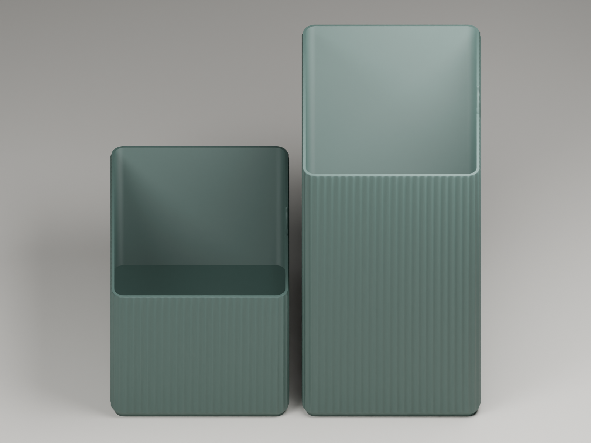
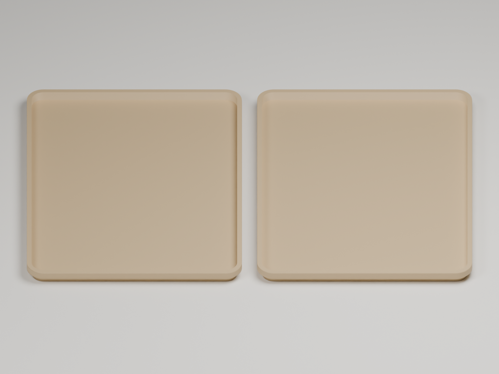

# StackBox · dos recipientes y dos tapas, en placas separadas

Dos archivos ya laminados para **Bambu Lab A1**, **boquilla de 0,4 mm**,
**Bambu PLA Basic** y **placa PEI texturizada**. Un filamento, sin AMS.

| Placa | Contenido | Tiempo estimado | Archivo listo |
| --- | --- | --- | --- |
| Recipientes | Un recipiente 3× y otro 6× | 14h 31m 33s | [Descargar laminado](Files/StackBox_A1_2_Recipientes.gcode.3mf) |
| Tapas | Dos tapas idénticas compatibles | 1h 55m 19s | [Descargar laminado](Files/StackBox_A1_2_Tapas.gcode.3mf) |

Abre el archivo **`.gcode.3mf`** en Bambu Studio para usar el laminado guardado.
Los [proyectos editables](Projects/) permiten modificar ajustes y volver a laminar.

## Distribución

Las piezas están giradas 90° y colocadas lado a lado, con **8 mm de separación**.
Cada placa tiene exactamente dos objetos, todos sobre Z = 0 y dentro de
256 × 256 × 256 mm. Se imprime por capas.





## Perfil incluido

- A1, boquilla de 0,4 mm, PLA Basic, PEI texturizado.
- Capas de 0,28 mm; capa inicial de 0,20 mm.
- 2 paredes, relleno grid del 15 %, sin soportes.
- Un filamento; torre de purga desactivada.

Los recipientes conservan las alturas exteriores de **99,34 mm** y
**198,68 mm**. Las dos tapas son iguales y encajan en ambas variantes.

## Archivos y comprobaciones

- [Proyecto editable: dos recipientes](Projects/StackBox_A1_2_Recipientes.3mf).
- [Proyecto editable: dos tapas](Projects/StackBox_A1_2_Tapas.3mf).
- [Distribución y piezas](Layout.json).
- [Verificación geométrica, laminado e integridad del G-code](Verification.json).
- [Sumas SHA-256 de los cuatro proyectos](SHA256SUMS.txt).

Ambas placas completaron el laminado en Bambu Studio. Las mallas son cerradas,
los objetos caben en la A1 y se comprobó el MD5 del G-code. La prueba física
permanece pendiente.

## Reproducir los proyectos editables

Desde la raíz del repositorio, con Python 3.10 o posterior:

```sh
python Scripts/Prepare-StackBox-Plates.py --output-dir LocalExports/StackBox-PrintPlates
```

El script reúne las geometrías archivadas y configura las dos placas. Los
renders y los archivos ya laminados son parte de esta publicación.

## Créditos

Diseño original de **Agro1223**; adaptación, variantes y preparación de placas
archivadas por **iiroak**. La atribución y el permiso de publicación están en
la [ficha de la adaptación](../../Designs/Storage/StackBox-105x147x28/Attribution.md).
