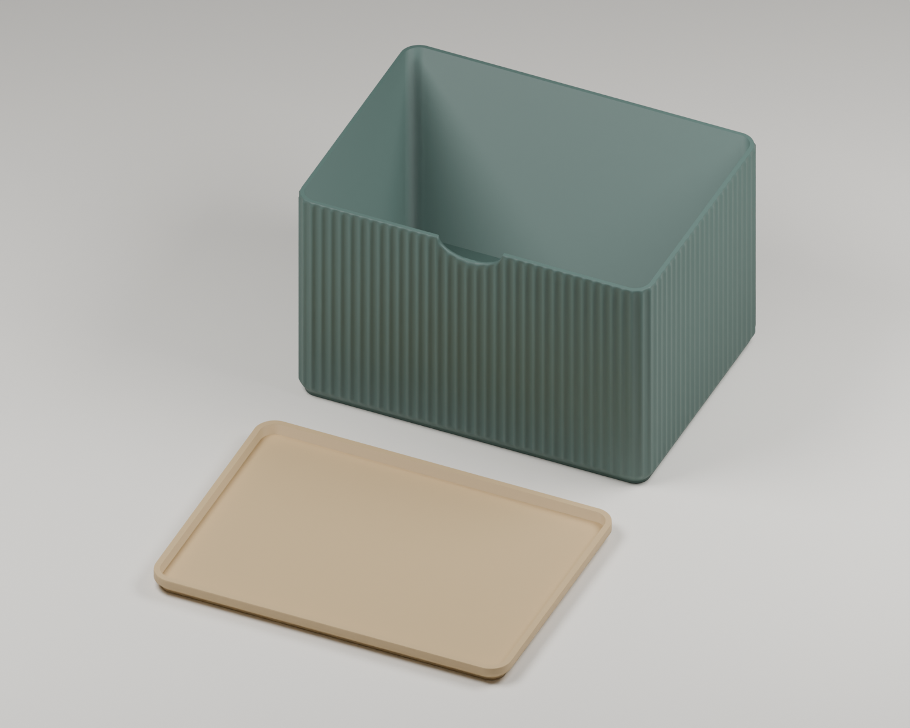
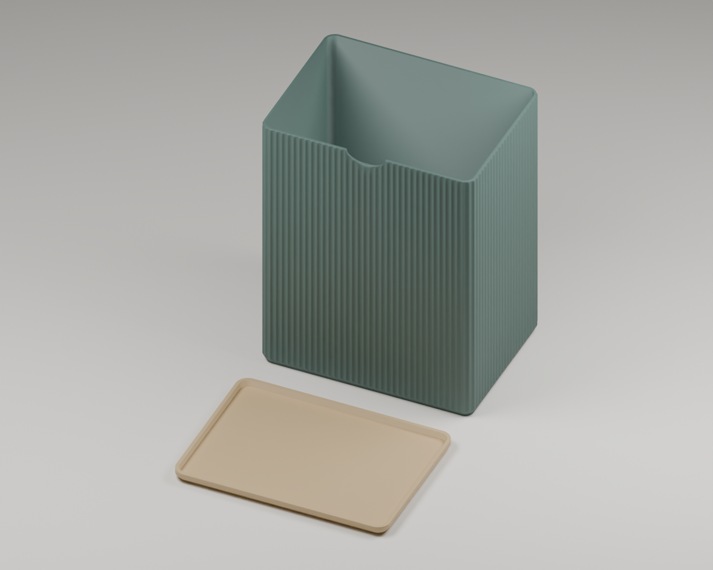

# StackBox · un pote y su tapa por proyecto

Cada archivo contiene **un pote y una tapa**, colocados por separado sobre
una misma placa de impresión. Hay un proyecto para la versión **3×** y otro
para la **6×**.

| Conjunto | Altura exterior del pote | Proyecto editable | Ya laminado | Tiempo estimado |
| --- | --- | --- | --- | --- |
| 3× · pote + tapa | 99,34 mm | [3MF](Projects/StackBox_A1_3x_Pote_y_Tapa.3mf) | [Listo para imprimir](Files/StackBox_A1_3x_Pote_y_Tapa.gcode.3mf) | 6h 3m 22s |
| 6× · pote + tapa | 198,68 mm | [3MF](Projects/StackBox_A1_6x_Pote_y_Tapa.3mf) | [Listo para imprimir](Files/StackBox_A1_6x_Pote_y_Tapa.gcode.3mf) | 10h 40m 1s |

Los laminados están preparados para **Bambu Lab A1**, **boquilla de 0,4 mm**,
**Bambu PLA Basic** y **placa PEI texturizada**, con un filamento y sin AMS.
Usa el 3MF editable para cambiar ajustes y el `.gcode.3mf` para abrir el
laminado guardado en Bambu Studio.

## Vista previa 3×

## Vista previa 6×

## Preparación y comprobaciones

- Dos objetos por placa: un pote y una tapa apoyados en Z = 0.
- Separación de 8 mm entre las piezas, dentro del volumen de la A1.
- Capas de 0,28 mm, 2 paredes, relleno grid del 15 %, sin soportes.
- Impresión por capas; geometrías y ajustes de las versiones individuales archivadas.
- Laminados completados en Bambu Studio y MD5 del G-code comprobado.
- Prueba física pendiente.

Los resultados están en [Verification.json](Verification.json) y las sumas
de los cuatro archivos en [SHA256SUMS.txt](SHA256SUMS.txt).

## Origen y reproducción

Los proyectos proceden de [StackBox 3×](../../Designs/StackBox-Height3x/) y
[StackBox 6×](../../Designs/StackBox-Height6x/), que ya incluyen un pote y una
tapa cada uno. Se pueden regenerar con `Scripts/Extend-StackBox.py`, usando
el factor 3 o 6 y volviendo a laminar en Bambu Studio.

Diseño original de **Agro1223**, adaptación y archivo de **iiroak**.
Consulta la [atribución y permiso de publicación](../../Designs/StackBox-105x147x28/Attribution.md).
